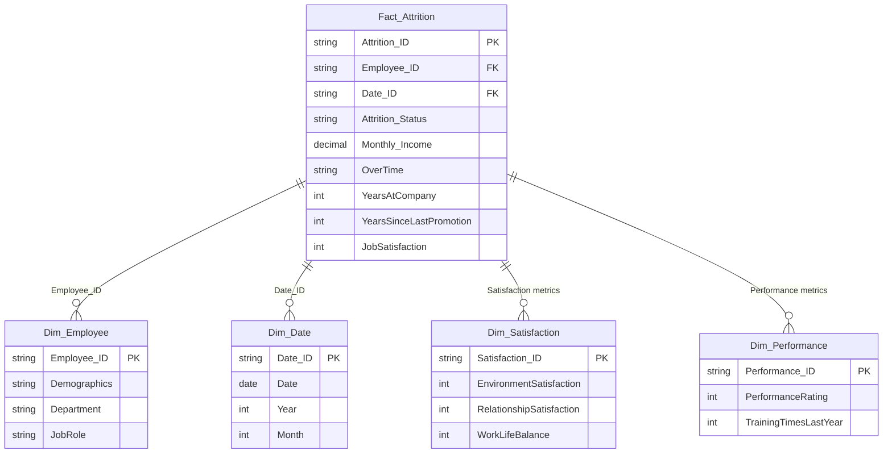

# 📊 HR Attrition Analysis & Dimensional Data Model

A comprehensive Human Resources (HR) Analytics project built in Microsoft Excel featuring a Star Schema Dimensional Data Model to analyze employee attrition trends, job satisfaction, performance dynamics, and retention drivers.

---

## 🚀 Overview

Employee attrition poses significant challenges to organizational stability and operational productivity. This project structures and analyzes HR data to uncover patterns and factors influencing employee turnover, enabling data-driven decision-making for HR leadership.

---

## 🗂️ Data Architecture & Schema

The dataset is structured using a **Star Schema** data modeling approach for optimized analytical reporting:



### Table Breakdown
1. **`Fact_Attrition`**: Central fact table storing transactional events, attrition status, salary details, overtime, and tenure.
2. **`Dim_Employee`**: Employee demographic details, job role, and organizational hierarchy.
3. **`Dim_Satisfaction`**: Granular scores covering job satisfaction, work-life balance, and relationship satisfaction.
4. **`Dim_Performance`**: Employee appraisal ratings and training milestones.
5. **`Dim_Date`**: Time dimension facilitating trend and cohort analysis over time.

---

## 🔍 Key Insights & Analysis Areas

- **Attrition vs. Compensation**: Evaluating attrition rates across monthly income bands and overtime frequency.
- **Tenure & Promotion Gaps**: Identifying high-risk attrition windows based on years at company vs. years since last promotion.
- **Workplace Satisfaction**: Impact of environment satisfaction, relationship rating, and work-life balance on employee departures.
- **Performance Correlation**: Analysis of high-performing vs. low-performing employee churn.

---

## 🛠️ Tools & Technologies

- **Microsoft Excel**: Data modeling, star schema integration, pivot tables, and analytical summaries.
- **Dimensional Modeling**: Fact and Dimension architecture design.

---

## 📁 Repository Structure

```
├── HR Attrition.xlsx    # Master Excel workbook with Star Schema model & tables
├── .gitignore           # Git ignore rules for Excel lock/temp files
└── README.md            # Project documentation & schema overview
```

---

## 👤 Author

- **Dhruv Panchal** ([@DhruvPanchal0312](https://github.com/DhruvPanchal0312))
