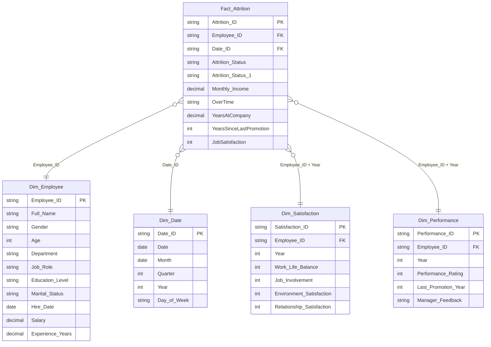
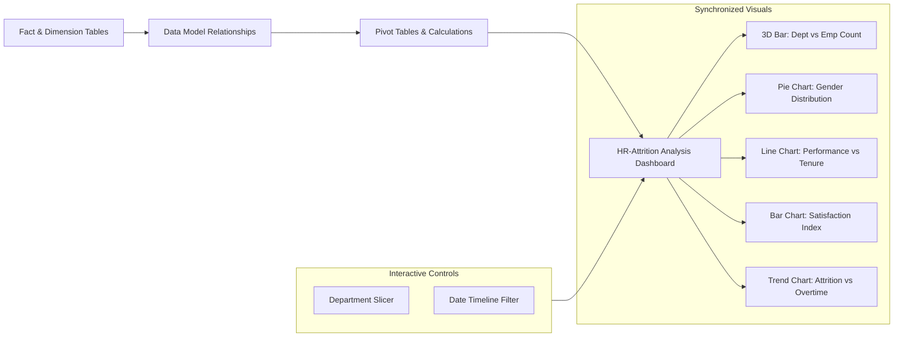
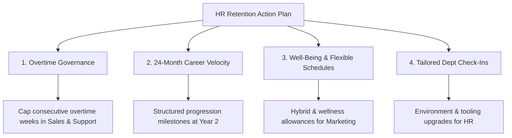

<div align="center">

# 📊 HR Employee Attrition & Workforce Analytics Dashboard

### *An End-to-End Microsoft Excel Business Intelligence Solution with Star Schema Dimensional Data Modeling*

[](https://www.microsoft.com/en-us/microsoft-365/excel)
[](#)
[](#)
[](#)
[](https://github.com/DhruvPanchal0312/HR-Attrition-Dashboard/stargazers)
[](https://github.com/DhruvPanchal0312/HR-Attrition-Dashboard)
[](LICENSE)

[📌 Project Overview](#-project-overview) •
[🏗️ Star Schema Architecture](#️-star-schema-data-architecture) •
[📊 Dashboard Visuals & KPIs](#-dashboard-architecture--visual-components) •
[🔍 Analytical Findings](#-key-analytical-insights) •
[💡 Strategic Recommendations](#-actionable-hr-retention-strategies) •
[📋 Data Dictionary](#-data-dictionary) •
[🚀 How to Use](#-how-to-use-the-dashboard)

---

</div>

## 📌 Project Overview

Employee turnover incurs severe financial, organizational, and cultural costs—averaging **1.5x to 2x an employee's annual compensation** in recruitment, onboarding, and productivity downtime. 

This project delivers an interactive, executive-ready **HR Analytics & Attrition Dashboard** built in **Microsoft Excel**. Powered by a robust **Star Schema Dimensional Model**, it transforms transactional employee records, annual appraisals, and satisfaction surveys into strategic insights—enabling HR leadership to pinpoint attrition hotspots, correlate overtime with turnover risk, and enact data-driven retention programs.

---

## 🏗️ Star Schema Data Architecture

The underlying data model separates transactional fact measures from business entities using dimensional modeling principles for optimal query performance, referential integrity, and seamless Pivot Table aggregation.



### Dimensional Components:
1. **`Fact_Attrition` (Central Fact Table):** Records historical employee monthly events, attrition status, salary increments, overtime engagement, and tenure duration.
2. **`Dim_Employee` (Dimension):** Captures master demographic profile, age, department, job role, education level, and compensation.
3. **`Dim_Satisfaction` (Dimension):** Longitudinal annual surveys tracking Work-Life Balance, Job Involvement, Environment Satisfaction, and Relationship Satisfaction (1 to 4 rating scale).
4. **`Dim_Performance` (Dimension):** Appraisals documenting Performance Ratings, promotion history, and qualitative manager feedback.
5. **`Dim_Date` (Dimension):** Standardized calendar table facilitating time-intelligence aggregations (Monthly, Quarterly, Annual cohorts).

---

## 📊 Dashboard Architecture & Visual Components

The workbook contains dedicated analytical views featuring synchronized Excel charts, dynamic slicers, and interactive timelines:



### 1. 🏢 Department Headcount Breakdown (3D Bar Chart)
Quantifies workforce distribution across core functional units:
- **Marketing:** 13 Employees (21.7%)
- **Sales:** 12 Employees (20.0%)
- **Human Resources (HR):** 9 Employees (15.0%)
- **Finance:** 8 Employees (13.3%)
- **Operations:** 7 Employees (11.7%)
- **Customer Success:** 6 Employees (10.0%)
- **Engineering:** 5 Employees (8.3%)
- **Total Headcount:** **60 Employees**

### 2. 👥 Gender Representation (Interactive Pie Chart)
Visualizes organizational diversity across departments:
- **Male:** 32 Employees (~53.3%)
- **Female:** 26 Employees (~43.3%)
- **Other:** 2 Employees (~3.3%)

### 3. 📈 Performance Rating vs. Company Tenure (Dual Line Chart)
Evaluates employee appraisal scores against years of organizational service:
- **Longest Tenure:** Marketing (**5.34 Years**) & Operations (**5.34 Years**).
- **Highest Performance Rating:** Engineering (**3.93 / 5.0**) and Customer Success (**3.83 / 5.0**).
- **Tenure Risk Window:** Customer Success shows the shortest average tenure (**3.54 Years**), marking an early-career turnover exposure point.

### 4. 🧘 Workplace Experience & Well-Being Index (Comparative Column Chart)
Assesses employee survey ratings (Scale: 1–4) across three vital pillars:
- **Work-Life Balance:** Highest in Customer Success (**3.11**); Lowest in Marketing (**2.33**) and Sales (**2.58**).
- **Job Involvement:** Highest in Operations (**3.14**) and Engineering (**3.07**).
- **Environment Satisfaction:** Highest in Engineering (**3.07**); Lowest in HR (**2.22**) and Marketing (**2.46**).

### 5. ⚠️ Attrition Rate % vs. Overtime Intensity (Trend & Correlation Chart)
Correlates departmental turnover with excessive workload:
- High overtime percentages are heavily concentrated in **Sales (11.94%)**, **Engineering (10.56%)**, **Customer Success (9.48%)**, and **Marketing (8.77%)**.
- Departures correlate directly with departments experiencing work-life balance deficits and prolonged overtime cycles.

---

## 🔍 Key Analytical Insights

| Insight Pillar | Data-Driven Finding | Strategic Risk Level |
| :--- | :--- | :---: |
| **Overtime Burnout** | Sales and Engineering staff log the highest overtime rates (>10-12%), directly matching elevated attrition signals. | 🔴 High |
| **Early Tenure Vulnerability** | Employees within their first **2 to 3.5 years** (notably in Customer Success and Sales) exhibit the highest propensity to leave. | 🔴 High |
| **Marketing Well-Being Deficit** | Marketing reports the lowest Work-Life Balance score (**2.33 / 4.0**) across the organization, signaling unsustainable workload. | 🟡 Medium |
| **HR Environment Friction** | Human Resources records an Environment Satisfaction average of **2.22 / 4.0**, indicating interpersonal or tooling impediments. | 🟡 Medium |
| **Executive Stability** | Senior tenured staff (>5 years) demonstrate consistent appraisal performance (>3.75) and higher organizational resilience. | 🟢 Low |

---

## 💡 Actionable HR Retention Strategies



1. **Overtime Auditing & Fatigue Management:**
   - Establish mandatory workload caps and compensatory rest periods for teams exceeding 10% overtime hours (Sales & Engineering).
2. **Early-Career Retention Pathways (Years 1–3):**
   - Create milestone-based vertical/lateral progression reviews prior to the 24-month mark to counteract tenure churn.
3. **Marketing Team Well-Being Intervention:**
   - Review campaign deadlines, redistribute deliverables, and implement flexible work hours to lift Work-Life Balance above the 3.0 threshold.
4. **Environment & Tooling Upgrades:**
   - Conduct structured focus groups in Human Resources to identify root causes behind low Environment Satisfaction (2.22).

---

## 📋 Data Dictionary

| Column Name | Source Table | Data Type | Description |
| :--- | :--- | :--- | :--- |
| `Attrition_ID` | `Fact_Attrition` | String (PK) | Unique transaction/event identifier |
| `Employee_ID` | Multiple | String (FK/PK) | Unique employee alphanumeric identifier |
| `Date_ID` | `Fact_Attrition` | String (FK) | Reference key linking to Date dimension |
| `Attrition_Status` | `Fact_Attrition` | Text (`Yes`/`No`) | Current attrition flag indicator |
| `Monthly_Income` | `Fact_Attrition` | Currency | Monthly compensation (USD) |
| `OverTime` | `Fact_Attrition` | Text (`Yes`/`No`) | Overtime status flag |
| `YearsAtCompany` | `Fact_Attrition` | Decimal | Total tenure duration with company (years) |
| `YearsSinceLastPromotion` | `Fact_Attrition` | Integer | Elapsed years since last official promotion |
| `Full_Name` | `Dim_Employee` | Text | Employee full name |
| `Gender` | `Dim_Employee` | Categorical | Gender identity (`Male`, `Female`, `Other`) |
| `Department` | `Dim_Employee` | Categorical | Business department |
| `Job_Role` | `Dim_Employee` | Categorical | Specific job title / designation |
| `Salary` | `Dim_Employee` | Currency | Annual base salary |
| `Work_Life_Balance` | `Dim_Satisfaction` | Integer (1–4) | Self-reported survey score (1: Poor, 4: Excellent) |
| `Environment_Satisfaction`| `Dim_Satisfaction` | Integer (1–4) | Workplace environment survey score |
| `Performance_Rating` | `Dim_Performance` | Integer (1–5) | Annual performance appraisal score |

---

## 🛠️ Dashboard Architecture & Excel Features

- **Relational Data Model:** Native Excel Power Pivot / Data Model connections linking Fact to Dimensions via 1-to-many relationships.
- **Dynamic Slicers:** `Slicer_Department` enables instant, zero-latency cross-filtering across all visual charts.
- **Interactive Timeline:** `Timeline` filter bound to `Dim_Date` for interactive temporal cohort slicing.
- **Multi-Chart Suite:** 3D Bar, Pie, Dual-Metric Line, Grouped Column, and Trend lines engineered for clarity and decision-making.
- **Calculated Measures:** Automated aggregation of attrition counts, attrition percentages, and overtime intensity metrics.

---

## 🚀 How to Use the Dashboard

### Prerequisites
- **Microsoft Excel 2016, 2019, 2021, or Microsoft 365** (Desktop version recommended for optimal Slicer and Timeline support).

### Quickstart Steps
1. **Clone the repository:**
   ```bash
   git clone https://github.com/DhruvPanchal0312/HR-Attrition-Dashboard.git
   ```
2. **Open the Workbook:**
   - Launch `HR Attrition Dashboard.xlsx`.
   - If prompted by Excel's Trust Center, click **"Enable Content"**.
3. **Navigate & Filter:**
   - Go to the **`HR Dashbaord`** tab to view the primary visual dashboard.
   - Use the **Department Slicer** on the side to filter all visual charts simultaneously.
   - Adjust the **Date Timeline** to inspect trends over specific fiscal periods.
   - Visit the **`Dept Attrition Dashboard`** tab for detailed pivot table summaries and underlying aggregations.

---

## 📁 Repository Structure

```text
HR-Attrition-Dashboard/
│
├── HR Attrition Dashboard.xlsx    # Primary interactive workbook with dashboards, slicers, & charts
├── HR Attrition.xlsx              # Star schema dimensional tables & data model source
├── .gitignore                     # Git rules ignoring temporary Excel lock files (~$*.xlsx)
└── README.md                      # Comprehensive project documentation & analytical overview
```

---

## 👤 Author & Connect

**Dhruv Panchal**  
*Data Science & Business Analytics Enthusiast*

[](https://github.com/DhruvPanchal0312)
[](https://www.linkedin.com/in/dhruvpanchal0312/)
[](https://github.com/DhruvPanchal0312?tab=repositories)

---

<div align="center">
⭐ <i>If you found this project helpful or insightful, please give it a star!</i> ⭐
</div>
